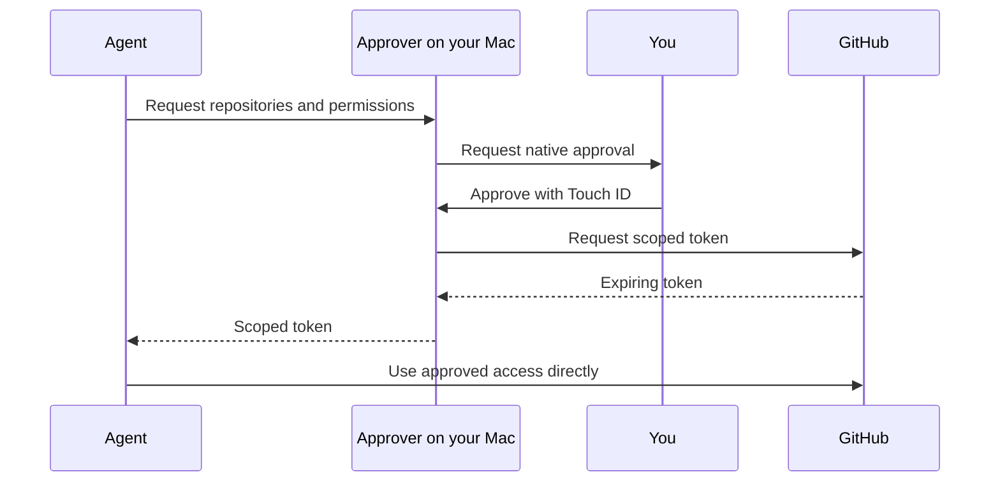

# How Passlet works

Passlet gives coding agents short-lived, scoped GitHub access after you approve a request on your Mac. Approver keeps the long-lived credentials in your Mac’s protected Keychain. Agent runs beside your coding tools, locally or on another machine.

## Install Agent

Approver requires macOS. Agent supports macOS and Linux. Follow the [installation guide](INSTALLATION.md) to configure Approver and set up GitHub first.

<Tabs syncKey="os" label="Operating system">
<Tab id="agent-macos" label="macOS" value="macos">

### Agent on macOS

The Homebrew cask includes both Approver and Agent:

```sh
brew tap paretosecurity/passlet https://github.com/ParetoSecurity/passlet.git
brew install --cask paretosecurity/passlet/passlet
```

</Tab>
<Tab id="agent-linux" label="Linux" value="linux">

### Agent on Linux

Install Agent with Homebrew:

```sh
brew tap paretosecurity/passlet https://github.com/ParetoSecurity/passlet.git
brew install paretosecurity/passlet/passlet-agent
```

You can also use [Nix or Home Manager](INSTALLATION.md#install-agent-on-a-remote-machine-or-vm).

</Tab>
</Tabs>

## How credentials move



The connection between Agent and Approver uses paired keys. It can run over a local Unix socket, an SSH-forwarded socket, or Tailscale. See [pairing](SETUP.md#pair-agents) and [Tailscale configuration](SETUP.md#tailscale).

<details>
<summary>What happens if your Mac goes offline?</summary>

### Access after disconnection

Delivered tokens continue working until they expire. New requests require Approver to be online and your approval. Passlet does not queue requests or approve them unattended.

</details>

## Next steps

- [Install and configure Passlet](INSTALLATION.md).
- [Pair a remote Agent](SETUP.md#pair-agents).
- [Troubleshoot access](SETUP.md#diagnostics).
